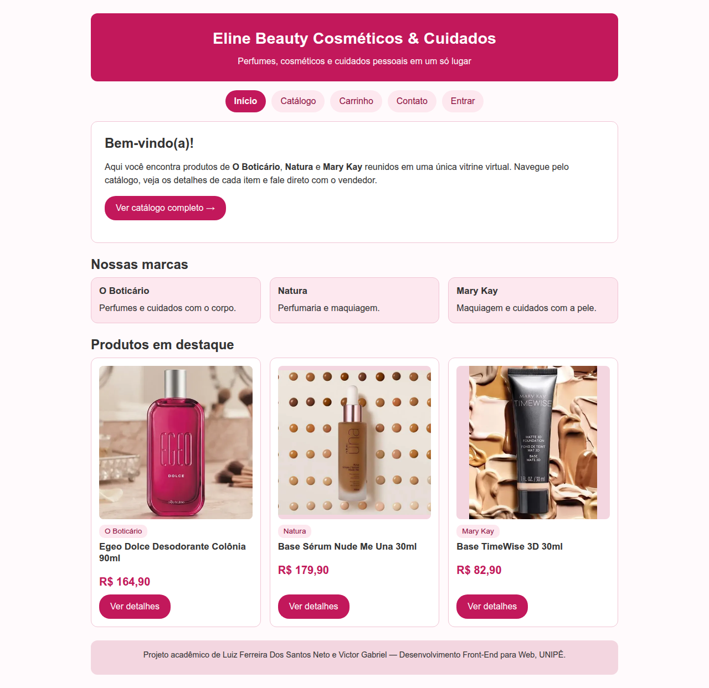
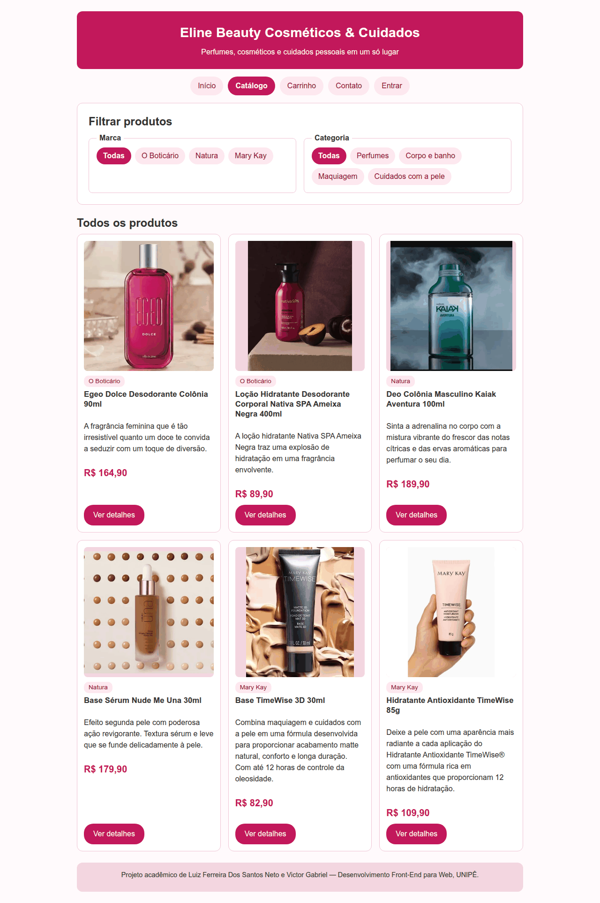
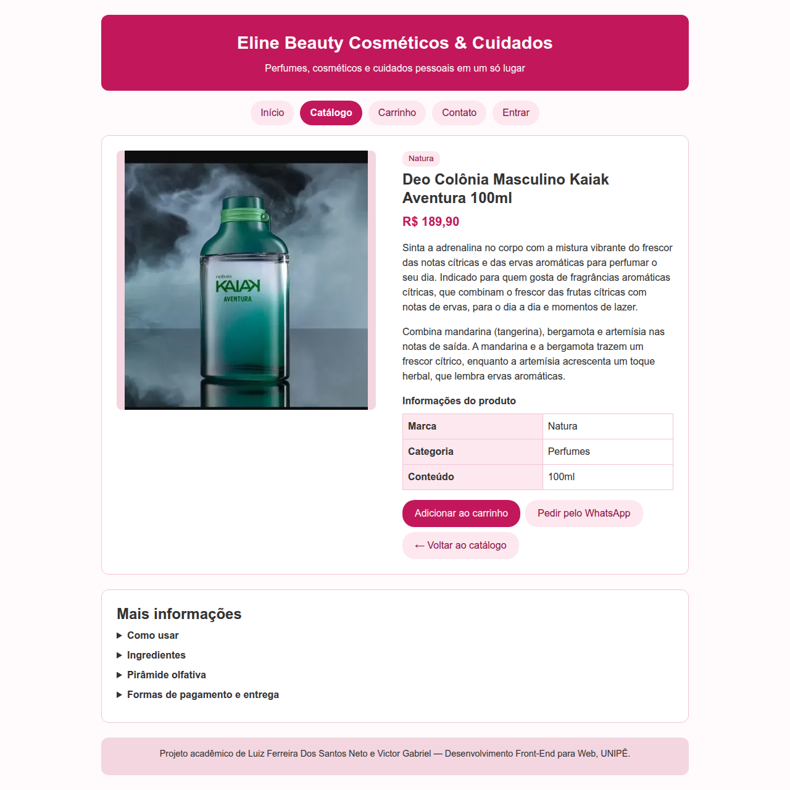

# Vitrine Virtual de Cosméticos

> 🚧 **Projeto em desenvolvimento.** Esta é uma versão em evolução e ainda vai receber novas páginas e melhorias.

Projeto final da disciplina de **Desenvolvimento Front-End para Web** (UNIPÊ), desenvolvido em dupla por
**Luiz Ferreira Dos Santos Neto** e **Victor Gabriel**.

## Sobre o projeto

Aplicação web que funciona como uma vitrine virtual de cosméticos e produtos de cuidados pessoais
de um vendedor independente, reunindo produtos de **O Boticário**, **Natura** e **Mary Kay** em um único lugar.

O objetivo é apresentar o catálogo de forma organizada e permitir que o cliente consulte informações e preços
e entre em contato com o vendedor, que não possui loja física.

## Tecnologias

- **HTML5** semântico (`header`, `nav`, `main`, `section`, `article`, `aside`, `figure`, `footer`)
- **CSS3** em arquivos externos: um arquivo global com variáveis, cores e componentes comuns, e um arquivo para cada página
- Layout responsivo (celular, tablet e computador) com CSS Grid, Flexbox e media queries

## Funcionalidades

- **Página inicial** com apresentação da loja, das marcas e dos produtos em destaque
- **Catálogo** com 6 produtos (imagem, marca, descrição e preço) e **filtros por marca e por categoria**, que podem ser combinados entre si; quando nenhum produto atende à combinação escolhida, uma mensagem é exibida. Cada card leva à página do seu próprio produto
- **Uma página para cada produto** com foto, preço, descrição, tabela de informações e detalhes expansíveis (`details` e `summary`) de uso, ingredientes, pirâmide olfativa, ocasião e pagamento
- **Botão "Pedir pelo WhatsApp"** em cada página de produto, que abre uma conversa com o vendedor já com uma mensagem pronta citando o produto
- **Carrinho demonstrativo** com itens de exemplo, subtotais, frete a combinar e total
- **Contato** com os dados do vendedor (WhatsApp e Instagram clicáveis) e formulário com validação nativa do navegador (campos obrigatórios, e-mail válido, telefone no formato brasileiro e tamanho mínimo da mensagem). O formulário abre o programa de e-mail do usuário; quem preferir pode falar direto pelo WhatsApp
- **Login e cadastro demonstrativos**: telas com validação nativa dos campos (e-mail válido, senha com no mínimo 8 caracteres, termos obrigatórios) que levam a uma página de confirmação. Não autenticam, não criam conta e não guardam nenhum dado
- **Página 404** simples, com link de volta ao início
- Menu de navegação igual em todas as páginas, com destaque para a página atual e o item "Entrar" para login e cadastro
- Favicon do site

## Acessibilidade e qualidade

- Link "Ir para o conteúdo" para navegação por teclado
- Indicação visível de foco nos links, botões e campos
- Todas as imagens com texto alternativo (`alt`), dimensões definidas e carregamento tardio (`loading="lazy"`) nas que ficam abaixo da dobra
- Links "Ver detalhes" com nome próprio para leitores de tela (cada um cita o produto)
- Ordem de tabulação lógica, testada no menu, nos filtros, nos cards e nos formulários
- Campos de formulário com `label`, inclusive os de quantidade do carrinho
- Hierarquia de títulos correta, com um `h1` por página
- Cada página com `title` e descrição próprios
- Arquivos de imagem com nomes padronizados (letras minúsculas, sem acentos e sem espaços)
- HTML validado no validador oficial do W3C (vnu), sem erros em nenhuma página
- Auditoria de acessibilidade com axe-core (WCAG 2.1 A e AA e boas práticas) em todas as páginas, em 360px e 1280px, sem violações
- Layout testado em 360px, 768px e 1280px de largura, sem rolagem horizontal
- Filtros do catálogo testados em todas as combinações de marca e categoria; formulários testados com campos vazios e inválidos

## Capturas de tela

|               Início               |                  Catálogo                  |                Produto                 |
| :--------------------------------: | :----------------------------------------: | :------------------------------------: |
|  |  |  |

## Páginas

| Página                          | Descrição                                                                                     |
| ------------------------------- | --------------------------------------------------------------------------------------------- |
| `index.html` (raiz)             | Início: apresentação da loja, marcas e produtos em destaque                                   |
| `html/catalogo.html`            | Catálogo com todos os produtos e filtros por marca e categoria                                |
| `html/produto.html`             | Detalhes do Egeo Dolce Desodorante Colônia 90ml (O Boticário)                                 |
| `html/produtonativa.html`       | Detalhes da Loção Hidratante Desodorante Corporal Nativa SPA Ameixa Negra 400ml (O Boticário) |
| `html/produtokaiak.html`        | Detalhes do Deo Colônia Masculino Kaiak Aventura 100ml (Natura)                               |
| `html/produtonude.html`         | Detalhes da Base Sérum Nude Me Una 30ml (Natura)                                              |
| `html/produtobasetimewise.html` | Detalhes da Base TimeWise 3D 30ml (Mary Kay)                                                  |
| `html/produtohidratante.html`   | Detalhes do Hidratante Antioxidante TimeWise 85g (Mary Kay)                                   |
| `html/carrinho.html`            | Carrinho de compras demonstrativo                                                             |
| `html/contato.html`             | Contato com o vendedor e formulário de mensagem                                               |
| `html/login.html`               | Tela de login demonstrativa                                                                   |
| `html/cadastro.html`            | Tela de cadastro demonstrativa                                                                |
| `html/conta.html`               | Página de confirmação do login e do cadastro (demonstração)                                   |
| `404.html` (raiz)               | Página de "não encontrado"                                                                    |

## Estrutura de pastas

```
html_vitrine_virtual/
├── index.html                   Página inicial
├── 404.html                     Página de "não encontrado"
├── html/                        Demais páginas (catálogo, 6 produtos, carrinho, contato, login, cadastro e confirmação)
├── css/
│   ├── global.css               Variáveis, cabeçalho, menu, cards, botões, tabelas e formulários
│   ├── index.css                Estilos da página inicial
│   ├── catalogo.css             Filtros e mensagem de "nenhum produto"
│   ├── produto.css              Estilos da página do Egeo Dolce
│   ├── produtonativa.css        Estilos da página da Nativa SPA Ameixa Negra
│   ├── produtokaiak.css         Estilos da página do Kaiak Aventura
│   ├── produtonude.css          Estilos da página da Base Sérum Nude Me Una
│   ├── produtobasetimewise.css  Estilos da página da Base TimeWise 3D
│   ├── produtohidratante.css    Estilos da página do Hidratante TimeWise
│   ├── carrinho.css             Estilos do carrinho (tabela vira cartões no celular)
│   ├── contato.css              Estilos da página de contato
│   ├── login.css                Estilos da tela de login
│   ├── cadastro.css             Estilos da tela de cadastro
│   ├── conta.css                Estilos da página de confirmação
│   └── 404.css                  Estilos da página 404
├── img/                         Fotos dos produtos e favicon
├── docs/                        Capturas de tela usadas neste README
└── README.md
```

## Como visualizar

Abra o arquivo `index.html`, que fica na raiz do projeto, no navegador, ou use a extensão **Live Server** do VS Code.

## Observações

- Projeto acadêmico, executado localmente, sem banco de dados e sem pagamento real.
- O carrinho é demonstrativo: os itens, as quantidades e os valores são fixos.
- O login e o cadastro são demonstrativos: validam os campos no navegador, mas não autenticam, não criam conta e não guardam dados.
- O formulário de contato abre o programa de e-mail do usuário para enviar a mensagem.
- O botão "Pedir pelo WhatsApp" abre uma nova aba com a conversa; o envio da mensagem é feito pelo próprio WhatsApp.
- Produtos, preços e informações de contato podem ser exemplos, a serem ajustados conforme o desenvolvimento.
